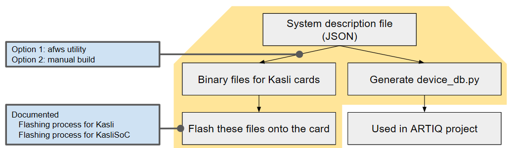

# Flashing Kasli & Kasli SoC

In this directory, you will find an introductary discussion on how to configure your Sinara hardware system, and a step-by-step tutorial on how to flash Kasli and Kasli SoC.

Reading order
1. [configure sinara system](./configure_sinara_system.md)
1. [flash kasli and kasliSoC](./flash_kasli_and_kasliSOC.md)

## A note on when to flash the Kasli
Note that in practice, reconfiguring most of the RTIO cards can be done by editing the `device_db.py` directly, instead of reflashing the entire Kasli card (reconfiguration such as changing the clock reference on your Mirny cards do not need reflashing). But doing so also diverge your `device_db.py` from the original file generated from the `system description JSON file` used to generate the Kasli binary. So consider this modification as a shortcut, and always keep an original version of the JSON configuration file. 

## High level workflow

